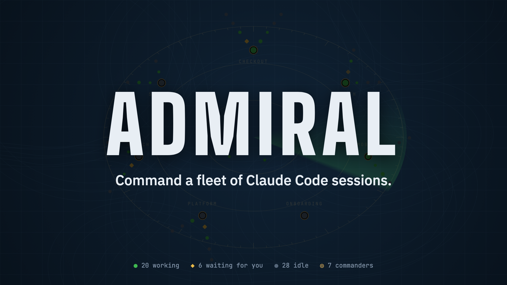
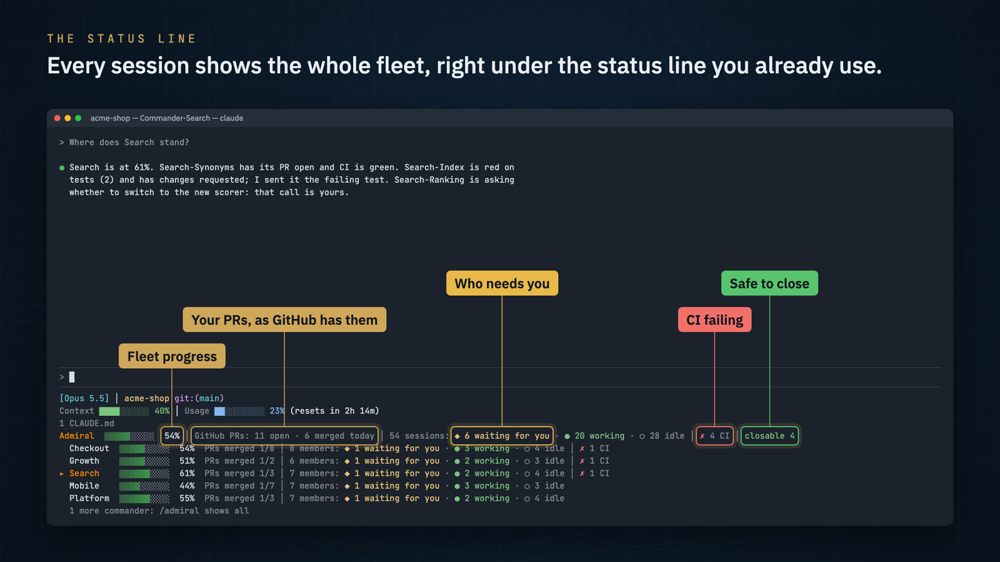
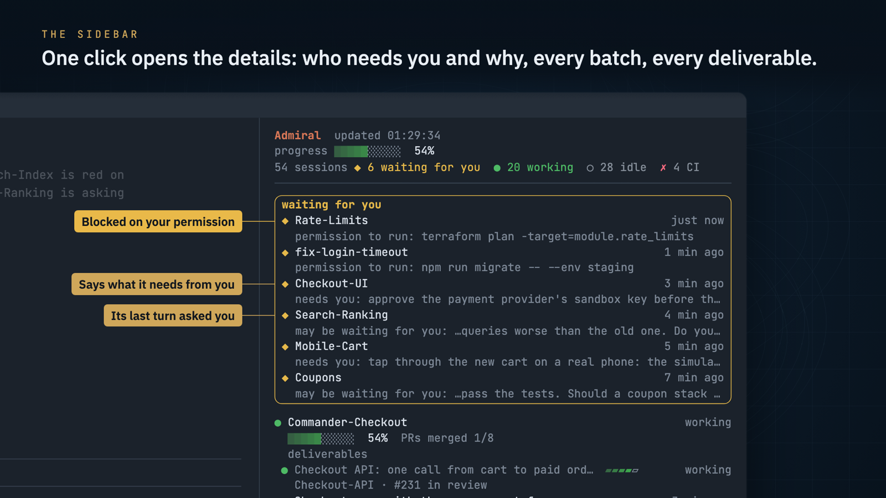
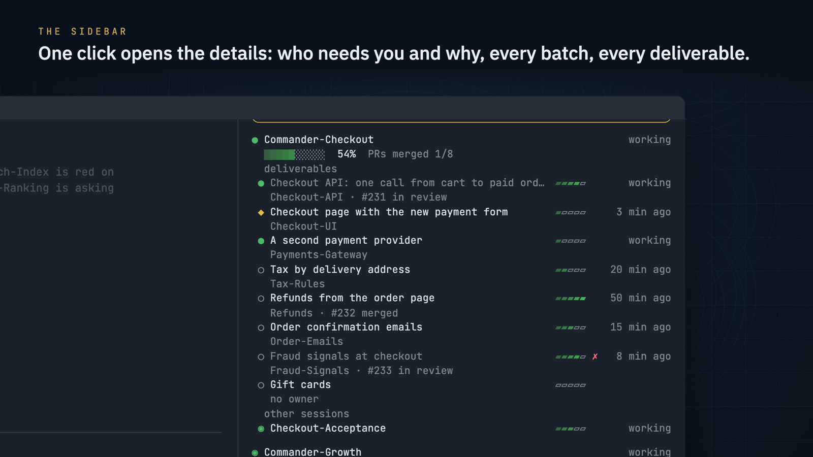
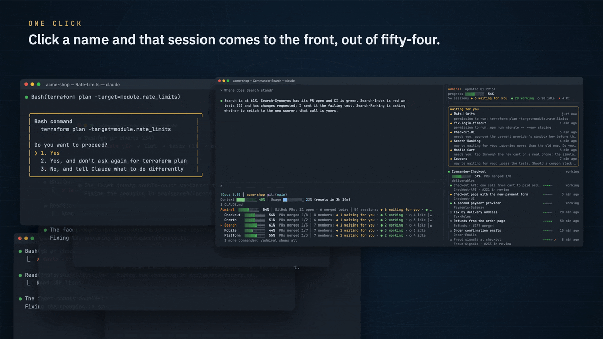
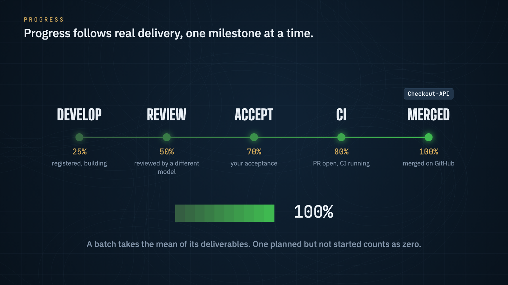
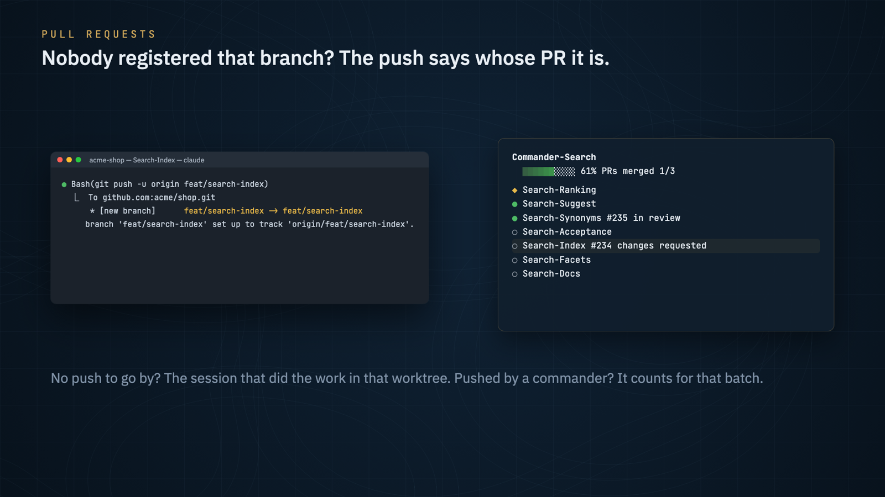
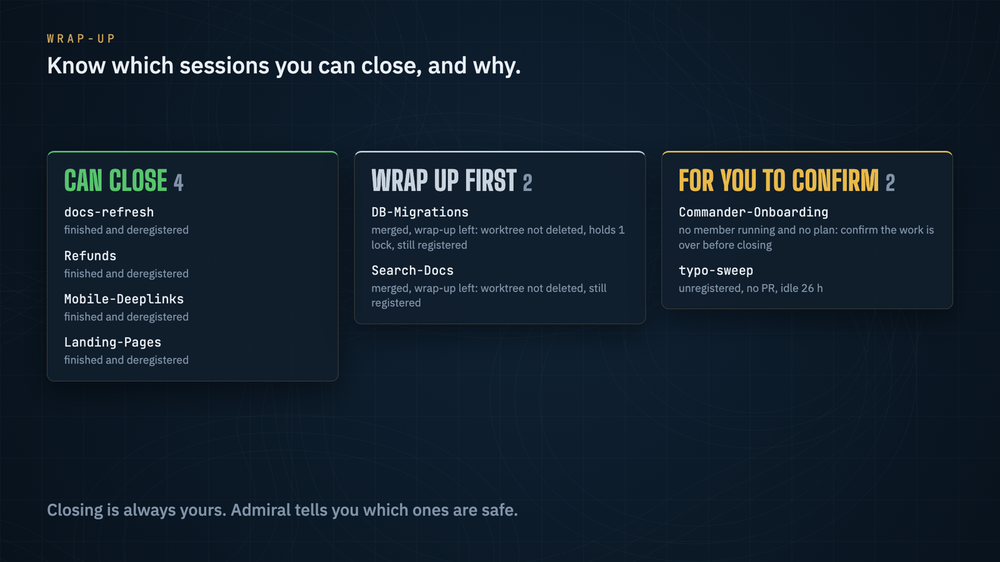
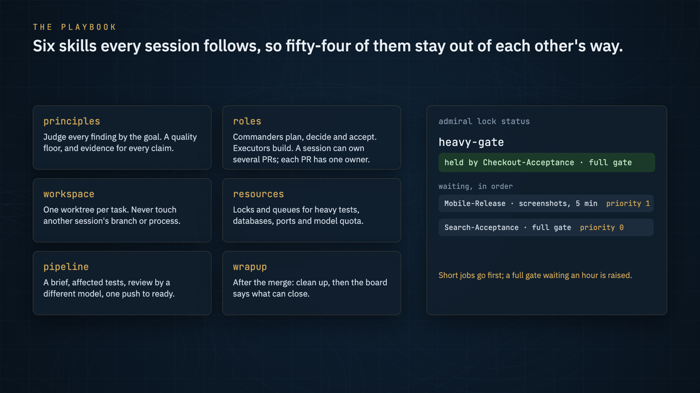

<p align="center">
  
</p>

<p align="center">
  <b>指挥一整支 Claude Code 舰队。</b><br>
  谁在等你一眼看清，对话之间互不干扰，每个 PR 一路推到合并。
</p>

<h3 align="center">瓶颈不再是你，而是你的 token。</h3>

<p align="center">
  <a href="https://github.com/onemoneki-sudo/Admiral/actions/workflows/test.yml"></a>
  
  
  
</p>

<p align="center"><a href="https://github.com/onemoneki-sudo/Admiral/releases/download/v0.2.0/admiral.zh.mp4"><b>▶ 观看宣传片</b></a> · <a href="https://github.com/onemoneki-sudo/Admiral/releases/download/v0.2.0/admiral.mp4">English</a></p>

<p align="center"><a href="README.md">English</a> · 中文</p>

---

**一个人，正在变成一支团队。** Admiral 来自每天的真实工作，不是凭空设计出来的：一个人在同一个产品上，
**同时并行运行近 50 个 Claude Code 对话**，由总指挥拆分每一批工作、指挥手下的对话。这就是软件开发正在走的方向。
到了这个规模，成败取决于三件事：

- **大任务并行。** 许多又大又难的任务同时推进，每个任务一个独立对话，按总指挥、按批次组织。这正是 Admiral
  的用途，小活用不着舰队。
- **不混乱。** 超过十来个对话，人就会乱：谁在等你批准，哪个批次卡住了，哪个 PR 挂了，哪些已经做完。Admiral
  在每个对话里一眼答清这些；它附带的协作规则让每个对话守住自己的工作区、分支和锁。
- **质量不打折。** 协作规则要求每个改动都由另一个模型审查、在关键处测试；Admiral 只按真实交付计算进度：
  审查、验收、CI、合并。

这一切都在 Claude Code 里完成，不打扰任何对话，不花一个模型 token。

## 适合谁

- **Claude Code 重度用户。** 你整天用 Claude Code 开发，同时开着很多对话，从六七个到五十个，做的是值得拆分的
  大工作：一个人做产品的独立开发者，带着一支对话舰队推进项目的技术负责人。Admiral 就是为你做的：在任何一个对话里，
  都能看到谁在等你、为什么等，每个批次按真实交付走到了哪，哪个 CI 挂了，哪些可以关，不花模型 token。
- **你的团队也这样工作。** 每个人为自己的舰队运行 Admiral，协作规则让所有人的对话遵守同一套规矩：一个任务一个
  工作区，共享资源先拿锁，换一个模型审查，一次推送直接 Ready。于是不管出自谁的对话，PR 都以同样的方式到来。
  每块面板显示的是一台机器上的对话，不是团队共享看板。
- **不适合你**，如果你同时只开一两个对话：Claude Code 本身就够了。

## 你能得到什么

### 整支舰队的状态栏



每个对话都能在你原来的状态栏下面看到整支舰队（上图原来的状态栏是 [claude-hud](https://github.com/jarrodwatts/claude-hud)，
Admiral 先运行它，原样保留）。

- **舰队总进度**：一根进度条，按交付里程碑计算，格子随进度从浅到深变成满绿。
- **你的 PR，以 GitHub 为准**：开着的，以及今天合并的。
- **对话**：等你处理的、工作中的、空闲的，以及在等你的对话名字。
- **CI 失败**和**可以关闭**的数量。
- **每个总指挥一行**，需要你的排在前面：批次进度、已合并的 PR、成员、CI。读到这一行的对话会看到自己负责的批次
  标着 `▸`；不是总指挥的对话有自己的一行：它的里程碑、它的 PR、它的总指挥。
- 终端太窄时，先省掉等待者的名字，数量始终保留。

### 侧边栏，所有细节都在



`/admiral`（或输入框上方的按钮）在右侧打开它，每十秒从同一份快照刷新。

- **待处理**，每一项都写明它要什么。对话等你有三种方式，Admiral 三种都能抓到：
  - **被拦住**：Claude Code 在请求你的权限（显示具体命令）；
  - **主动说明**：对话说了它需要你做什么（`admiral state --phase needs_you --note "…"`）；
  - **在问你**：它最后一轮以一个问题结束，而你还没回答。
- **每个批次**，挂在它的总指挥下面：进度、已合并的 PR，以及计划里的每个交付物，带负责人、PR、五步里程碑、
  失败的 CI 和最近活动。没人开工的交付物也会如实显示。

  

- **独立对话**：不归任何总指挥的那些。
- **收尾**：哪些对话可以关，哪些要先收尾，哪些需要你来决定。
- **待整理**：没登记的、改过名的、空闲好几天的，或者 PR 合并后还登记着的对话。

### 一键跳到等你的那个对话



开着五十多个对话时，难的是找到正在等你的那个。点击侧边栏里任意一个名字，它的终端标签页就跳到最前面
（macOS：终端和 iTerm2）。

### 进度可信



进度跟着真实交付走，从不估算：一个对话或交付物处在**开发**、**审查**（由另一个模型）、**验收**（你来）、
**CI**（PR 已开）或**合并**，每一步占固定比例。一个批次取各交付物的平均；计划了但没开工的按 0 算，已合并的在
对话关闭后照样计入。

### PR 找到它的主人



一个对话的 PR，是它登记过的分支和它的工作区当前检出的分支对应的 PR。如果对话换了分支却没登记，Admiral 照样能
找到这个 PR 属于谁：看哪个对话的 `git push` 输出更新了它；没有的话，看谁明显在那个工作区里干了活；再没有，
就算进推送它的总指挥的批次。这个 PR 随即计入，面板会提醒主人去登记。

### 知道哪些可以关



每个对话都有结论和原因：**可以关闭**（PR 已合并且收尾完成）、**待收尾后关闭**（已合并，但工作区或锁还没清）、
**需要你确认**（没有成员在运行的总指挥，空闲一天且没有 PR 的对话），或者继续保留。关不关永远由你决定。

### 协作规则，和锁



六套技能，Claude Code 在用得上时自动加载，让几十个对话互不干扰：

| 技能 | 规定了什么 |
|---|---|
| principles | 每个发现都按目标判断；质量底线；每个说法都要有证据；什么时候该停 |
| roles | 总指挥拆任务、做决定、带验收；执行对话写代码；一个批次怎么划分 |
| workspace | 一个任务一个工作区；登记；绝不能碰的东西（别人的分支、共享的 git 状态、按名字杀进程） |
| resources | 重测试、数据库、浏览器、端口和模型额度，先拿锁、按顺序排队 |
| pipeline | 从任务书到合并：只跑受影响的测试，换一个模型审查，必要时才跑完整门禁，一次推送直接 Ready |
| wrapup | 合并之后：安全清理，然后关闭 |

`admiral lock` 守住对话之间共享的东西：同一时间只跑一次完整测试，几个数据库名额，模型额度，端口。短任务优先；
完整门禁排满一小时自动提级；崩溃的对话不会一直占着锁，下一个排队的会接手。你的项目有自己的规定时，以项目为准。

## 一分钟试用

```sh
admiral demo --lang zh
```

用 Admiral 真实的面板代码，搭一支虚构的舰队：7 个总指挥、54 个对话，然后告诉你怎么在 Claude Code 里打开它。
不碰你的任何东西。

## 工作原理

```
Claude Code 的对话注册表 ─┐
对话记录 ─────────────────┤                                   ┌─ 状态栏（每个对话）
登记与计划 ───────────────┼─▶ admiral board --write ─▶ 面板 ─┼─ 侧边栏（点一下就到）
GitHub（gh：PR、检查）────┤      每分钟一次                   └─ board.md（总指挥读它）
锁 ───────────────────────┘
```

一个后台任务每分钟生成一次面板，所有对话读同一份快照。有对话在工作时，每次刷新问 GitHub 四次（最多约六个 API
请求）；所有对话都空闲 30 分钟后，改为每 15 分钟一次；没有对话在运行时，完全不问。这不到 GitHub 每小时额度的十分之一。

对话记录从上次读到的地方接着读，每个缓存都有上限，所以五十个对话连续跑好几天也依然很快。当 Claude Code 的内部文件
不再是预期的样子，面板会用红字说明，而不是悄悄显示错误的数字。

## 安装

要求：后台任务和一键跳转需要 macOS（其他系统用 cron 或 systemd 定时器每分钟运行 `scripts/refresh.sh`，其余功能
都一样）；Python 3.11 或更新；已登录的 GitHub 命令行 `gh`；侧边栏需要支持插件函数钩子的 Claude Code
（抢先体验功能，按 2.1.299 开发）。

```sh
git clone https://github.com/onemoneki-sudo/Admiral.git ~/admiral
~/admiral/scripts/install.sh       # 配置模板、后台任务、把 admiral 加到 PATH；--dry-run 只显示会做什么
```

然后有两步需要你自己做，因为 Admiral 从不自己修改 Claude Code 的设置：

1. **状态栏**：在 `~/.claude/settings.json` 里写上安装脚本打印的那一行：
   ```json
   "statusLine": {"type": "command", "command": "'/Users/you/admiral/bin/admiral' statusline", "refreshInterval": 20}
   ```
   你原来的状态栏（比如 claude-hud）会保存在 Admiral 的配置里，依然先运行。
2. **侧边栏和协作规则**：
   ```sh
   claude plugin marketplace add ~/admiral
   claude plugin install admiral@admiral
   ```

最后，在 `~/.config/admiral/config.toml` 里设置 `project_dirs` 和 `[github] repo_dir`。
`scripts/install.sh --uninstall` 会移除后台任务和链接。

**更新**：`git -C ~/admiral pull`，然后在开着的对话里运行 `/reload-plugins`，一切都从克隆目录运行。
改了什么见 [CHANGELOG.md](CHANGELOG.md)。

## 配置

`~/.config/admiral/config.toml`（或 `$ADMIRAL_CONFIG`）。每一项都可以不写。

```toml
language = "zh"                        # 或 "en"

[sessions]
project_dirs = ["~/code/myapp"]        # 只显示在这里工作的对话；留空显示所有对话
commander_prefix = "总指挥"             # 名字以它开头的对话是总指挥（默认 "Commander"）

[github]
repo_dir = "~/code/myapp"              # gh 在这里读 PR 和检查
summary_checks = []                    # 只是汇总其他任务的 CI 任务：只有其他都没失败时才点名

[statusline]
base = ""                              # 先运行的状态栏命令

[progress]                             # 每个里程碑占多少
develop = 25
review = 50
accept = 70
ci = 80
merged = 100
```

## 日常使用

**总指挥和成员。** 名字以总指挥前缀开头的对话是总指挥。其他对话归它登记里写明的总指挥；没写的话，归它最近
收到消息的那个总指挥。

**登记。** 对话说明自己在做什么、进行到哪一步；协作规则会让每个对话都这样做：

```sh
admiral register --who "<对话名>" --task "<任务>" --branch <分支> --worktree <路径> --lead "<总指挥>"
admiral state    --who "<对话名>" --phase review        # working, waiting, needs_you, review, accepting, paused, done
admiral done     --who "<对话名>"
```

**计划。** 总指挥记下自己的批次要交付哪些 PR，进度就会把每一个都算进去：

```sh
admiral plan add   --lead "<总指挥>" --branch <分支> --title "<交付物>" --owner "<对话>"
admiral plan close --lead "<总指挥>"
```

**命令。**

```
admiral register | state | done | list          登记
admiral plan add | rm | list | close            总指挥的计划
admiral board [--now | --write] [--no-github]   最新的面板，Markdown 格式（--now 现场重新生成）
admiral statusline                              状态栏（从标准输入读 Claude Code 的 JSON）
admiral lock acquire | release | status | port  共享资源的锁
admiral focus <tty>                             把一个对话的标签页调到最前（macOS：终端、iTerm2）
admiral demo [--lang zh]                        一支虚构的舰队，不用自己的舰队也能看效果
admiral where                                   状态目录
```

## 读取什么与数据去向

- **读取**，只在你的电脑上：Claude Code 的对话注册表和对话记录（`~/.claude`）；`ps`，用来获取每个对话的启动时间
  和终端；`git`，只读，在你的仓库和登记过的工作区里；锁的持有者；安装时读一次 `~/.claude/settings.json`，
  用来保留你的状态栏。
- **写入**：它的状态目录（`~/.local/state/admiral`）和你拿的锁；安装时写入它的配置、后台任务、
  `~/.local/bin/admiral` 链接和克隆目录里的 `.python-path`。
- **发送**：只有以你的身份调用 `gh` 向 GitHub 查询 PR 和检查。不调用任何模型，不上传任何东西。

## 为什么用对话，而不是子智能体

子智能体擅长一个对话内部的有限任务：搜代码、审一段 diff、汇报结果。要干几个小时甚至几天的交付物，需要一个
独立的对话：

- **整个任务放在一个上下文里，直到做完。** 子智能体为它的上级干活，交回一段摘要；对话保留自己的任务、决策和历史，
  能连续持续好几天。
- **你能直接和它说话。** 每个对话都是一个终端，你可以切过去回答、改方向或叫停，Admiral 会告诉你哪个在等你。
  子智能体只能通过启动它的那个对话来沟通。
- **每个 PR 一个负责人。** 每个对话在自己的工作区和分支里干活，把自己的 PR 从第一次提交一路带到合并，
  归属、审查和进度都清清楚楚。
- **不会把一个上下文塞满。** 每个子智能体的汇报都要进入上级的上下文，一个上级能装下的有限。五十个对话则通过
  Admiral 的面板向你汇报，谁也不用替别人扛着。

对话内部照样用子智能体做小事。Admiral 管的是对话本身。

## 和编排平台有什么不同

像 Google 的 [Scion](https://github.com/GoogleCloudPlatform/scion) 这样的平台替你运行智能体：每个在自己的容器里，
可以扩展到集群，彼此协调。Admiral 什么都不运行。它架在你本来就在终端里运行的 Claude Code 对话之上，你随时可以和
其中任何一个说话；它补上的是一个人管住几十个对话所需要的东西：谁在等你，每个批次按真实交付走到了哪，哪些可以关，
以及一套让它们互不干扰的协作规则。没有容器，没有集群，不花 token。

## 局限

- Claude Code 的对话注册表和对话记录是内部文件，不是 API。当它们不再是预期的样子时，Admiral 会明说，而不是悄悄
  显示错误的数字；但 Claude Code 更新后，Admiral 仍可能需要跟着更新。
- 侧边栏用的是 Claude Code 的抢先体验插件 API，各版本之间会有变动。
- 它只能看到这台电脑上的对话，而且只看 Claude Code 的对话。
- 进度按里程碑计算：它看不出开发本身做到了几成。

状态：早期，尽力维护。

## 常见问题

**要花钱吗？** 不要。Admiral 免费（MIT 开源），不调用任何模型，所以不花你一个 token。它唯一的网络请求是用 `gh`
向 GitHub 查询你的 PR 和检查，不到 GitHub 每小时额度的十分之一。

**我的代码和数据会离开我的电脑吗？** 不会。它在本地读 Claude Code 的文件、`ps` 和 `git`，除了那些 `gh` 调用
（以你的身份）什么都不发送。见[读取什么与数据去向](#读取什么与数据去向)。

**会拖慢 Claude Code 吗？** 不会。状态栏读的是后台任务已经生成好的快照，在你原来的状态栏之外大约多花 70 毫秒；
后台任务每分钟才运行一次。不会询问或打断任何对话。

**它会启动、停止或指挥对话吗？** 不会。它什么都不运行，也不往任何对话里输入东西：指挥的是你和你的总指挥。
在侧边栏里点一下，只是把那个对话的终端标签页调到最前面。

**我需要改变工作方式吗？** 一点点。总指挥用前缀命名，对话登记自己在做什么；协作规则会让它们自己去做。不登记的话，
Admiral 照样显示每个对话、谁在等你，也能从推送记录找到 PR 的主人；登记和计划让进度从估算变成精确。

**只开两三个对话值得用吗？** 不值得：Claude Code 本身就够了。Admiral 从六七个对话、做值得拆分的大工作开始才划算。

**Linux 呢？Windows 呢？** macOS 上全部功能可用。Linux 上除了一键跳转都能用，后台的每分钟任务目前需要你自己
安排（cron 或 systemd 定时器）。Windows 没有测试过。

**团队能共用一块面板吗？** 暂时不能。每个人为自己的舰队运行 Admiral，协作规则让所有人遵守同一套规矩；团队视图在
下面的演进路线里。

**为什么用对话而不是子智能体？** 见[为什么用对话，而不是子智能体](#为什么用对话而不是子智能体)。

## 演进路线

Admiral 每天都在用，并公开开发。下面是计划，不是承诺；欢迎在 issue 里提想法、一起做。

接下来：
- **不靠自觉的登记**：对话推送分支或创建工作区时自动登记，面板不再依赖对话记得去登记。
- **对话开始等你时发通知**：可选，给你没在看状态栏的时候。
- **完整支持 Linux**：安装脚本自动设置后台任务，常见终端（包括 tmux）支持一键跳转。
- **不只 Claude Code**：其他编码智能体的对话，比如 Codex，也能显示在同一块面板上。

更远：
- **团队视图**：把几台电脑的面板汇到一起，自愿开启。
- **历史**：每个批次在每个里程碑停留多久，工作卡在哪里。
- **正式接口**：Claude Code 一提供正式接口，就不再读它的内部文件。

## 开发

```sh
python3 -m unittest discover -s tests      # 每次推送和 PR 时 GitHub Actions 也会运行（Linux 和 macOS）
claude plugin validate plugin
claude --plugin-dir plugin                 # 开一个从工作目录加载侧边栏的对话
```

怎么参与贡献，以及 issue 里不要放什么：[CONTRIBUTING.md](CONTRIBUTING.md)。安全问题报告：[SECURITY.md](SECURITY.md)。

宣传片和上面的图片都来自 Admiral 在演示舰队上的真实输出：先运行 `docs/film/build_assets.py`，再运行
`docs/film/render.py`（需要 Playwright 和 ffmpeg）。

发布新版本：同时提高 `admiral/__init__.py` 里的 `__version__` 和 `plugin/.claude-plugin/plugin.json` 里的版本号，
把 `CHANGELOG.md` 里 `Unreleased` 下的内容移到新版本下面，给这个提交打上 `v<版本号>` 标签。

## 致谢

Admiral 的状态栏是为了接在 Jarrod Watts 的 [claude-hud](https://github.com/jarrodwatts/claude-hud)（MIT）下面而做的：
它先原样运行你的 claude-hud，再在下面加上自己的几行，进度条也按 claude-hud 的风格绘制。Admiral 不包含 claude-hud
的任何代码。感谢作者做了一个值得在上面继续搭建的开源状态栏。

## 许可证

MIT，见 [LICENSE](LICENSE)。
